<table>
<tr>
<td valign="middle" width="37%">
<h1><small>Odoo Multi-Branch Inventory &amp; Transfers</small></h1>

<strong>Odoo 19 Community</strong> Developed by Ahmed Solangi

Compare availability across warehouses. Track transfers from source approval through confirmed receipt.

Python · PostgreSQL · XML/QWeb · JavaScript/Owl

<a href="#transfer-lifecycle">Workflow</a> · <a href="#application-screens">Demo screens</a> · <a href="#solution-architecture">Architecture</a>

</td>
<td valign="top" width="63%">
<a href="assets/screenshots/en/01-transfer-dashboard.png">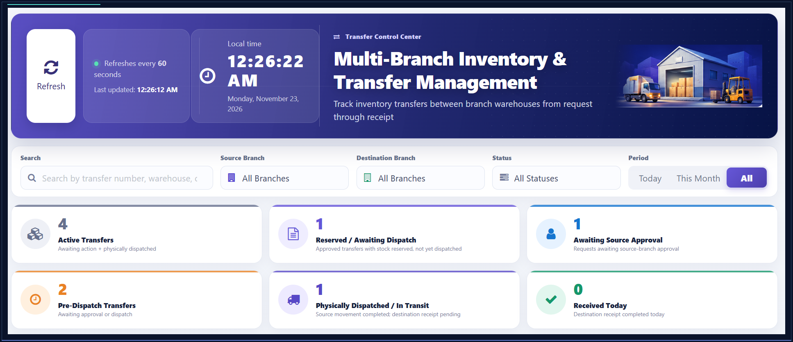</a>

Transfer dashboard · <a href="assets/screenshots/en/01-transfer-dashboard.png">Open full-size capture</a>

</td>
</tr>
</table>

## Project overview

When stock is spread across branches, operators need to know whether they can allocate it, whether it has left the source, and whether the destination has received it. I built this Odoo solution to make those decisions visible in a warehouse stock matrix and a transfer dashboard backed by separate source and destination stock operations.

The isolated demonstration contains three branch warehouses, 20 sample products, opening stock and eight sample transfers spanning seven statuses. This portfolio case study contains selected demonstration screenshots, high-level engineering documentation and an independent Python example. The complete installable Odoo modules are private.

## Warehouse network

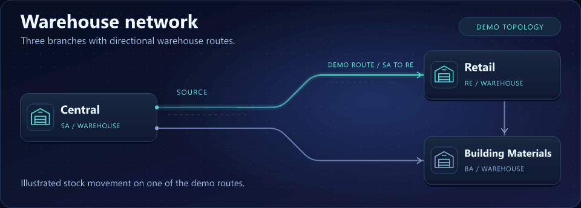

The three demo branches each have one operational warehouse. The animation follows the Central-to-Retail route depicted in the demo. [Static network diagram](assets/branding/warehouse-network.svg)

## Demonstrated capabilities

| Capability | What the demo shows |
| --- | --- |
| Branch stock visibility | Compare warehouse quantities and see on-hand, reserved and available stock for each product. |
| Source approval | Review a submitted request under the source warehouse’s responsibility before approving it. |
| Reservation and dispatch | Reserve the full request at approval, then complete the source stock movement at physical dispatch. |
| Destination receipt | Confirm the receiving leg to move stock from transit into the destination and complete the transfer. |
| Operational monitoring | Filter transfers, inspect directional routes and read pre-dispatch, transit and history separately. |
| Access scope | Scope stock views to permitted warehouses and apply transfer record rules and warehouse action checks. |

## Transfer lifecycle

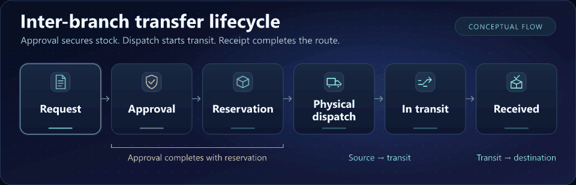

**Request → Approval → Reservation → Physical dispatch → In transit → Received.** Approval and full reservation complete together in this implementation. The approved record is displayed as **Reserved / Awaiting Dispatch**. Completing the source picking starts transit. Completing the destination picking confirms receipt. [Static lifecycle diagram](assets/branding/transfer-workflow.svg)

The **Pre-Dispatch Transfers** dashboard card combines requests awaiting source approval and approved requests awaiting dispatch. **Physically Dispatched / In Transit** counts only dispatched transfers awaiting receipt. **Received Today** uses the receipt date in the user’s local day. Rejected and cancelled records retain separate history statuses.

## Inventory visibility

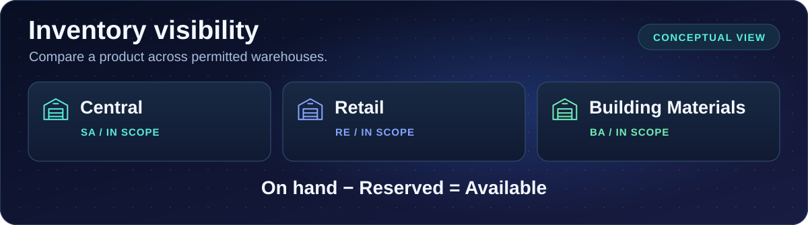

Current Stock scopes quantities to internal locations under each permitted warehouse’s stock root. It shows per-warehouse quantities alongside on hand, reserved and available for the selected scope. Transit sits outside these warehouse totals. The [inventory logic](docs/warehouse-inventory-logic.md) explains the metric and status definitions.

## Application screens

Each image opens at full resolution. The English and Arabic galleries show the same isolated demo at different capture times. Time-sensitive figures such as **Received Today** can differ between them.

### English gallery

**Transfer dashboard**  
Review pending source approval, reservations, dispatched stock and receipts at a glance.

**Warehouse stock matrix**  
Compare product quantities across three warehouse columns and review aggregate availability by row.

[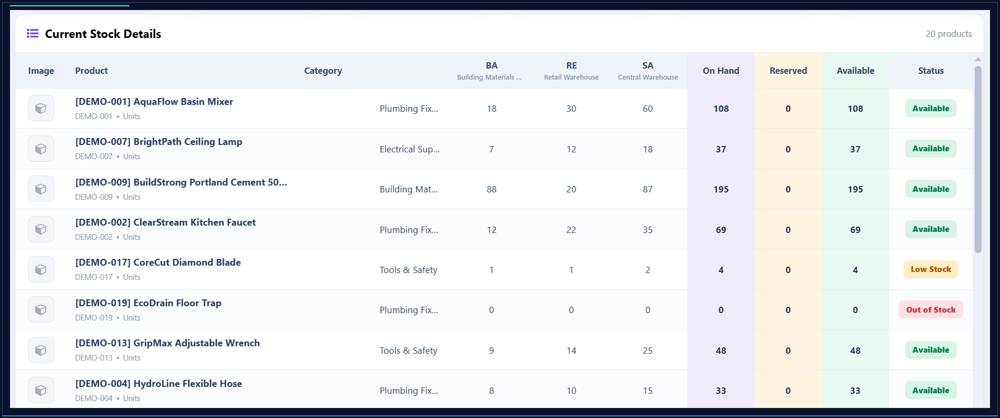](assets/screenshots/en/02-warehouse-stock.png)

**Transfer routes**  
Inspect the source, destination and pre-dispatch or in-transit counts for each active route.

[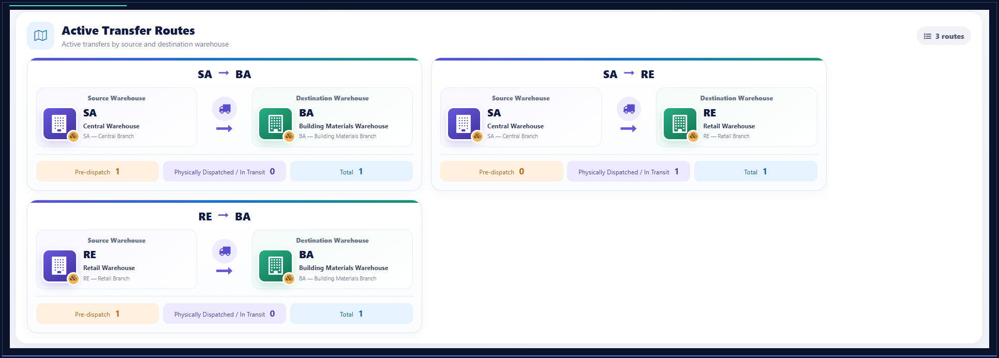](assets/screenshots/en/03-transfer-routes.png)

**Dispatch and transfer history**  
Compare pre-dispatch requests with physically dispatched stock. The history panel preserves distinct received, cancelled and rejected outcomes.

[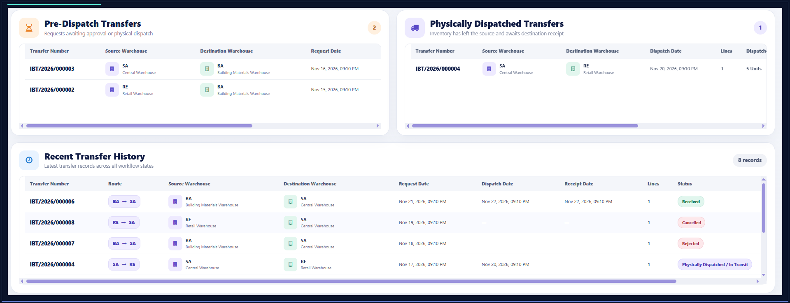](assets/screenshots/en/04-dispatch-and-history.png)

**Confirmed receipt**  
The received transfer shows both stock-operation links and the requested, dispatched and received quantities for its demo line.

[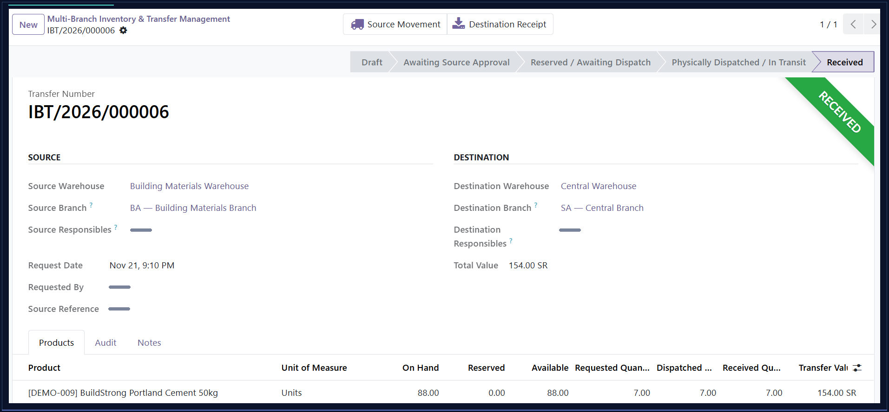](assets/screenshots/en/05-received-transfer.png)

### Arabic gallery

Arabic dashboards use right-to-left layout. Demo product names, warehouse names and identifiers retain their stored spelling. Some inherited form elements and stock KPI labels retain their original orientation or English copy.

<strong>لوحة متابعة التحويلات</strong> ملخص طلبات التحويل والحجز والإرسال والاستلام.

[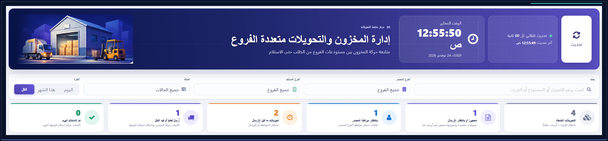](assets/screenshots/ar/01-transfer-dashboard.png)

<strong>نظرة عامة على المخزون الحالي</strong> مرشحات الفروع والمستودعات والفئات وملخص حالة المنتجات.

[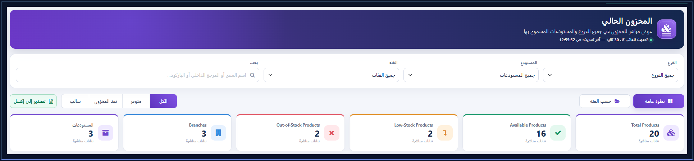](assets/screenshots/ar/02-stock-overview.png)

<strong>تفاصيل المخزون حسب المستودع</strong> كميات المنتجات في المستودعات الثلاثة وحالة التوفر.

[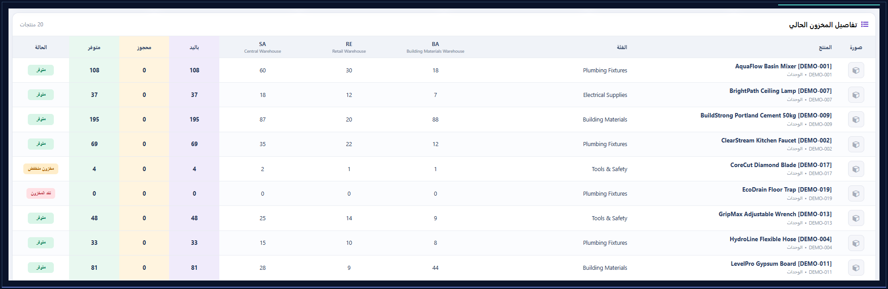](assets/screenshots/ar/03-warehouse-stock.png)

<strong>الإرسال الفعلي وسجل التحويلات</strong> طلبات ما قبل الإرسال والتحويلات المرسلة فعليًا وسجل الحالات.

[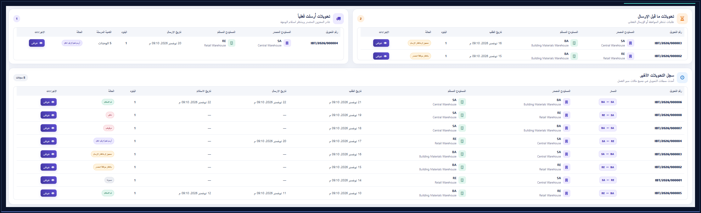](assets/screenshots/ar/04-dispatch-and-history.png)

<strong>تحويل مؤكد الاستلام</strong> حالة الاستلام وحركتا المصدر والوجهة والكميات المسجلة.

[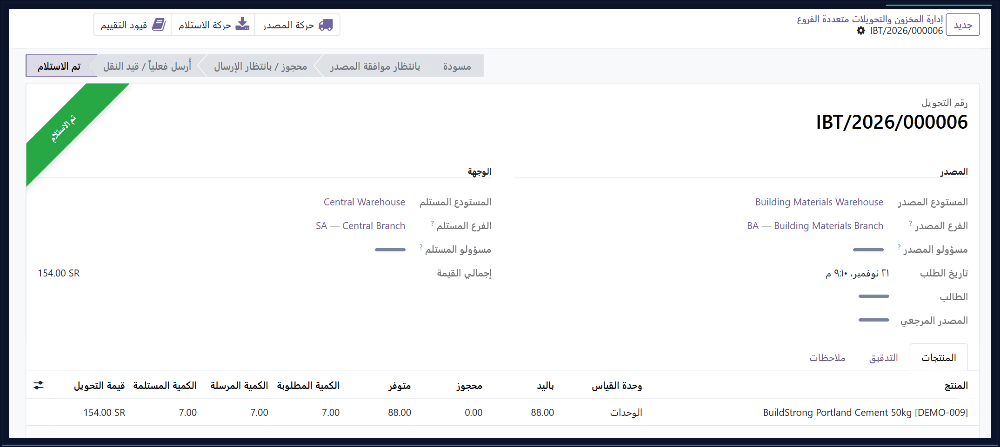](assets/screenshots/ar/05-received-transfer.png)

## Solution architecture

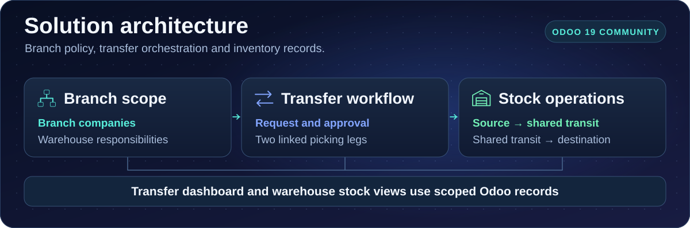

Branch companies and warehouse responsibilities define the operating scope. A transfer coordinates two Odoo stock pickings through a shared transit location. An Owl/QWeb dashboard reads filtered transfer history, while a companion stock view aggregates inventory by permitted warehouse.

## Engineering decisions

- **Track custody with two stock operations.** Dispatch and receipt are separate events, each backed by its own completed picking and recorded at the appropriate branch.
- **Reserve stock at approval.** Approval succeeds only when Odoo can assign the full source quantity. Dispatch rechecks stock and the reservation before completing the outbound leg.
- **Keep record visibility and action authority distinct.** Requesters and assigned warehouse users can see relevant transfers under record rules. Source approval and dispatch and destination receipt have warehouse-specific action checks.
- **Keep the dashboard consistent with the workflow.** It counts transfers by state and uses location-scoped stock for warehouse quantities. Mixed units stay distinct when a single total would be ambiguous.

## Illustrative Python example

The [read-only Odoo ORM example](examples/illustrative_odoo_example.py) groups standard stock quants by product under one warehouse’s internal stock locations. It uses the caller’s active company context and returns on-hand, reserved and available values in each product’s unit of measure.

## Technical documentation

| Document | Coverage |
| --- | --- |
| [Solution architecture](docs/architecture.md) | Branch model, Odoo components, access controls and localization |
| [Inter-branch transfer workflow](docs/interbranch-transfer-workflow.md) | State transitions, reservation, picking legs and exceptions |
| [Warehouse inventory logic](docs/warehouse-inventory-logic.md) | Stock scope, quantity calculations and dashboard metrics |

## Developer

**Ahmed Solangi** · Odoo ERP Developer  
[GitHub](https://github.com/ahmedsolangi) · [LinkedIn](https://www.linkedin.com/in/ahmedsolangi)
