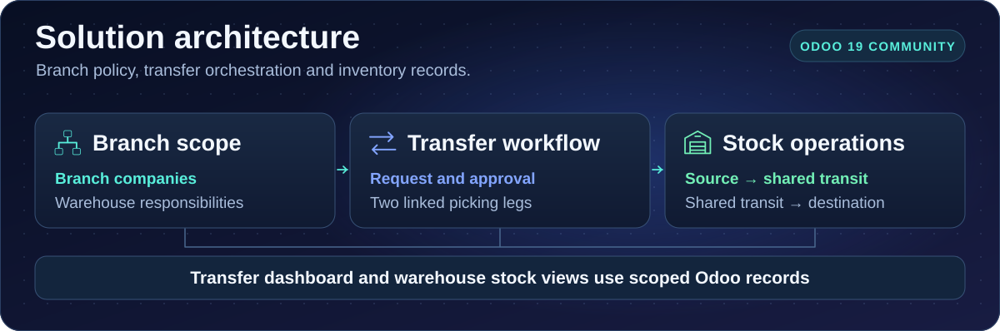

# Solution architecture

The Odoo 19 Community demo is organized around branch scope, a transfer that coordinates two stock operations, and two read views for different questions. The transfer dashboard answers where a request is in its lifecycle. Current Stock answers what is available at each warehouse.

## Components

| Layer | Responsibility |
| --- | --- |
| Branch configuration | Represents branches as Odoo child companies. A warehouse belongs to its branch company and provides the internal stock location for that branch’s leg of a transfer. |
| Transfer coordination | Stores the source, destination, product lines, state and linked pickings. It records who approved, dispatched and received a transfer when those actions occur. |
| Stock operations | The source picking moves stock into a shared transit location. The destination picking moves it from transit into the receiving warehouse. Each picking belongs to the company for its leg. |
| Transfer dashboard | An Owl client action with QWeb templates presents allowed branch filters, state counts, route summaries and recent records. |
| Current Stock | A separately installed product and stock component provides the warehouse matrix. It groups standard quant data within permitted internal locations. |
| Persistence | The Odoo ORM stores workflow, stock and configuration records in PostgreSQL and applies Odoo model access and record rules. |

The demo has three operational warehouses, one per branch. The stock view resolves them using company and warehouse configuration. The transfer component uses Odoo stock accounting and checks required valuation configuration on the two sides before relevant operations. The case study shows workflow and stock evidence from the isolated demo.

## Permissions and responsibility

| Control | Effect |
| --- | --- |
| Transfer record rules | Ordinary transfer users can see requests they raised or transfers tied to a warehouse they are responsible for. Managers and system administrators have broader transfer visibility. |
| Action checks | For ordinary users, source approval, rejection and dispatch require responsibility for the source warehouse and access to its company. Receipt uses the corresponding destination check. System administrators have an explicit override. |
| Stock view scope | Requires inventory access. Warehouse and branch filters are checked against the warehouses the user can access. |
| Cross-company coordination | After source authorization, the workflow can prepare the technical destination counterpart in the destination’s company context. Receipt has its own destination authorization. |

## English and Arabic UI

The demo has English and Arabic locales, translated action and menu labels, and RTL dashboard and stock layouts. Record values such as warehouse names and product identifiers are maintained as demo data. Some KPI labels and inherited form elements preserve their source presentation. Captures retain the original layout and use opaque masks where account or internal reference text was removed.

Continue with the [transfer workflow](interbranch-transfer-workflow.md) and [warehouse inventory logic](warehouse-inventory-logic.md).
