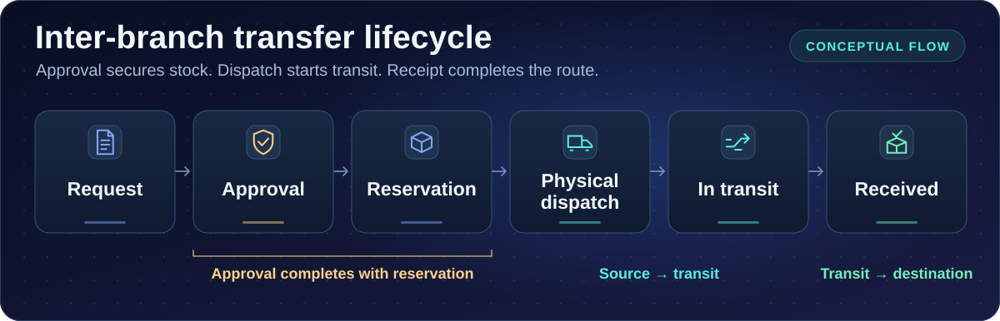

# Inter-branch transfer workflow

The transfer is the business record connecting two stock operations across branches. The source picking runs from source stock to transit. The destination picking runs from transit to destination stock. The shared transit location has transit usage and sits outside the internal warehouse stock location trees.

## States and stock effects

| State or action | Evidence and stock effect |
| --- | --- |
| Draft | The request can be edited. It carries product lines and a proposed route. |
| Awaiting Source Approval | Submission records the request for source review. There is no transfer reservation or dispatched stock at this point. |
| Reserved / Awaiting Dispatch | Approval checks configuration and source availability, prepares both pickings and requires the source to reserve the full quantity. Stock remains physically at the source and the reservation reduces free stock. |
| Physical dispatch | The source operator rechecks availability and assignment and completes the source picking into transit. This action records the dispatch event and enters the transit state. |
| Physically Dispatched / In Transit | The source picking is complete and destination receipt is still open. The dashboard counts this state in transit. |
| Received | The destination operator confirms receipt and completes the destination picking. This records received quantities and moves stock into destination stock. |
| Rejected | The source rejects a request awaiting approval and records a reason. |
| Cancelled | Cancellation is allowed before dispatch. It cancels related pending pickings when present. A dispatched transfer requires a separate controlled reversal. |

## Why dispatch has its own step

The team can reserve goods while they are being prepared and dispatch them later. The workflow keeps reservation as a pre-dispatch condition and uses the completed outbound picking as the custody boundary. At dispatch it accounts for the transfer’s own reservation so that a fully reserved request can be validated against the source’s usable stock.

The transfer record locks route and line edits after submission. Its two pickings, action history and line quantities give reviewers records to reconcile if the dashboard and warehouse activity need to be compared.

## Evidence from the demo

| Example | Source picking | Destination picking |
| --- | --- | --- |
| Reserved / Awaiting Dispatch | Assigned | Confirmed |
| Physically Dispatched / In Transit | Done | Confirmed |
| Received | Done | Done |

See the [English and Arabic screenshots](../README.md#application-screens) and [dashboard count definitions](warehouse-inventory-logic.md#transfer-dashboard-counts).
