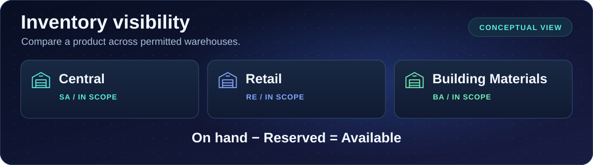

# Warehouse inventory logic

Current Stock groups Odoo stock quants for the selected products under the stock roots of permitted warehouses. It uses internal locations and the companies in scope. The demo has three operational warehouses and stocked example products in each. The separately installed stock view presents the comparison, while the transfer module uses source-scoped Odoo product quantities to validate requests.

## Quantities and scope

| Value | Meaning |
| --- | --- |
| On hand | Stock recorded in the internal locations under the selected warehouse or warehouses. |
| Reserved | The portion assigned to stock operations within the same location scope. |
| Available | On hand less reserved, in the product’s unit of measure. |
| Warehouse columns | Per-warehouse quantities in the selected metric. The stock capture shows on-hand by warehouse alongside aggregate quantities and availability. |
| Transit | Stock between a completed source dispatch and destination receipt. The transit location is outside the warehouse totals. |

The stock view provides branch, warehouse, category and text filters. With the demo’s stock-status rule, positive available stock up to and including five product units is *Low Stock*. Zero is *Out of Stock*, and negative availability has its own status. The category summary avoids combining quantities across different units into a single meaningful total.

## Transfer dashboard counts

| Card | Definition in the current filter scope |
| --- | --- |
| Active Transfers | Draft, awaiting source approval, approved/reserved and in transit. |
| Awaiting Source Approval | Submitted requests awaiting a source decision. |
| Reserved / Awaiting Dispatch | Approved transfers with stock reserved at the source. |
| Pre-Dispatch Transfers | Awaiting source approval plus approved/reserved transfers. This card overlaps the two counts above. |
| Physically Dispatched / In Transit | Source dispatch completed and destination receipt pending. |
| Received Today | Received transfers with a receipt timestamp in the user’s local calendar day. |

Route summaries group pre-dispatch and in-transit activity by directional warehouse pair. The dashboard’s period filter scopes request dates. **Received Today** additionally checks receipt date, which is why the same demo can show different counts across capture dates.

The [illustrative ORM example](../examples/illustrative_odoo_example.py) demonstrates a read-only aggregation for one warehouse using standard Odoo records. See the [Odoo 19 ORM reference](https://www.odoo.com/documentation/19.0/developer/reference/backend/orm.html#odoo.models.Model._read_group) for grouped-query behavior.
